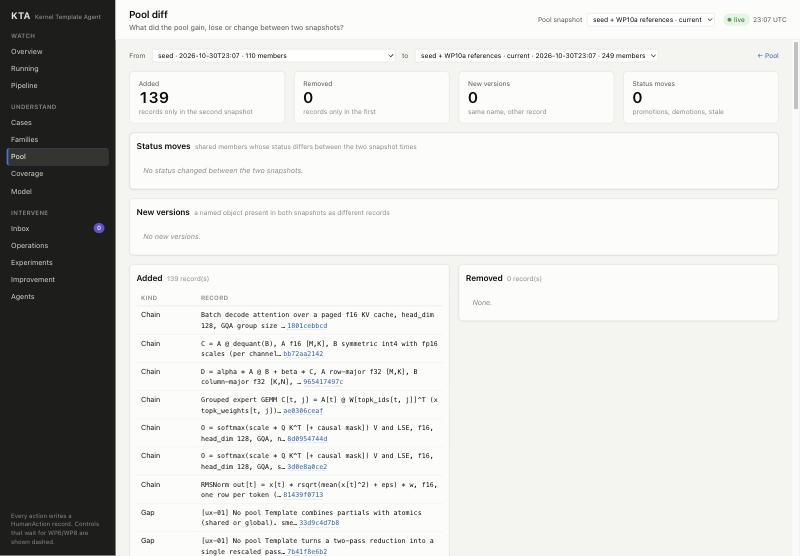

# WP14 Knowledge model v2 — delivery (code stage, D320)

Branch `wp/WP14` (from `integration` @ d34b52e). Code stage only: no real run, no GPU job, no experiment. Everything below is code, tests and seed data; "real run" claims are listed under "Pending real runs".

## What was done

| Capability | Where | Shown by |
| --- | --- | --- |
| Schema versions with upcast on read (D440): `KindSpec.upcasters`, `Record` keeps the stored body for hashing, `body` is the current shape; Pattern, Template, Gap, Reconstruction are schema 2 | `src/kta/core/schemas/{registry,envelope,upcast}.py` | `test_old_template_reads_back_upcast_with_its_stored_id`, `test_old_pattern_gap_and_reconstruction_levels_are_mapped`, `test_a_newer_schema_than_the_code_is_refused`; a copy of the existing store `dev/integration` (201 records, 108 of them schema 1) reads back with every ID unchanged (evidence 3) |
| Levels 1–7 with the versioned mapping `paper-0to5@1` (D441) | `src/kta/core/schemas/levels.py`; web `LEVELS`/`LEVEL_NAMES`, `--lv1..7` | `test_level_mapping_is_versioned_and_total_on_old_levels`; seed migrated |
| Capability + CapabilityDecl replace HwFeature in `Template.requires` (D442) | `core/schemas/hardware.py`, `knowledge/capabilities.py`, `knowledge/templates.py` | `test_seed_declares_gb10_capabilities`, `test_capability_is_inferred_from_an_isa_probe`, `test_requires_must_name_a_capability`, legacy path `test_required_hw_feature_must_be_yes_on_target` |
| Realisation split from Template (D443); SASS checks read realisations (D453) | `core/schemas/knowledge.py`, `knowledge/realisations.py`, `orchestrator/pipeline.chain_sass` | legacy realisation in the upcast test; `test_sass_expectation_from_constant_binding` (seed realisation), `test_sass_when_is_evaluated_over_item_bindings` |
| Finding unifies Regime and Negative; Coupling (`coupled_with`) with evidence and scope (D444, D447) | `knowledge/findings.py` | `test_legacy_regime_and_negative_read_as_findings`, `test_a_finding_from_another_chip_is_a_prior`, `test_couplings_filter_by_member_and_target` |
| `probed_on` + capability filter in retrieval + coverage "known, unavailable here" / "unconfirmed here" (D445) | `knowledge/retrieve.py` (`target=`, `unavailable_templates`), `knowledge/coverage.py` (`availability`) | `test_unprobed_template_is_filtered_on_gb10_and_counted` (FA3's wgmma pipelining hidden on GB10 and counted; cluster multicast unconfirmed), `test_target_declaring_a_capability_wakes_the_template_up` |
| One status ladder with evidence rules; templates keep assurance (D446) | `knowledge/ladder.py` | `test_promotion_needs_the_evidence_of_its_step`, `test_templates_keep_assurance_and_are_not_on_the_ladder` |
| Promotion/demotion engine on top of stale propagation (D448); store rule: system demotes | `knowledge/promotion.py`, `store/status.py` | `test_demotion_steps_down_and_propagates_stale`, `test_only_the_system_demotes_and_never_up`, `test_review_proposes_promotions_out_of_the_finding_layer` |
| Pool diff: `GET /pool/diff` + web page `/pool/diff` (D449) | `knowledge/pooldiff.py`, `api/pool.py`, `api/read.py`, `web/src/pages/PoolDiff.tsx` | `test_pool_diff_between_two_snapshots`; page rendered on seed data (below) |
| Seed migration, idempotent, recorded (D450, D451) | `scripts/migrations/WP14_knowledge_v2.py`, ledger `knowledge/seed/migrations.yaml`; new `knowledge/seed/capabilities/`, `targets/gb10/`, `realisations/` | `test_seed_migration_is_idempotent`; `--check` reports nothing pending on the repository seed |
| API serves upcast bodies (D452); new kinds in snapshots and search (D454) | `api/common.py`, `api/studies.py`, `orchestrator/expand_work.py`, `store/textindex.py` | `test_api_envelope_shows_upcast_body_and_stored_body` |
| Worker skills updated | `src/kta/agents/skills/{decompose-kernel,write-template,find-knowledge}/SKILL.md` | text |
| Spec | `spec/schemas.md`, `spec/modules/{knowledge,core-store,api-web}.md`, `spec/gate.md` (WP14 row); module READMEs; changelog entry | — |
| Gate | `tools/kta_gate/specific_wp14.py` registered in `specific.py`; `__main__.py` accepts WP14–WP21 | gate output below |

Evidence (`deliveries/WP14.evidence.json`, outputs under `Mac.lan:~/kta-data/dev/WP14-code-41cc17f/evidence/`):

1. pytest of the WP14 tests and the knowledge, schema, SASS and WP1/WP4 acceptance tests at 41cc17f: 108 passed.
2. `kta init --references` into a fresh dev store at 41cc17f: seed 58 records (16 Capability, 16 CapabilityDecl, 7 Template, 1 Realisation), references 139 (30 Template, 17 Realisation); migration `--check` clean.
3. Read-back of a copy (sqlite `.backup`) of `~/kta-data/dev/integration/kta.db`: 201 records, upcast Pattern v1 11, Template v1 35, Gap v1 55, Reconstruction v1 7; 0 problems, every ID unchanged. The original store was opened read-only and not changed.
4. Web build from `git archive HEAD web` at 41cc17f.

Pool diff page on seed data (scratch dev store: snapshot "seed" = 110 pool records vs "seed + WP10a references" = 249): `deliveries/WP14-pool-diff.png`.



## Fixtures and simplifications

- No new `# kta:fixture` marker. `src/kta/store/bench.py` (existing marker, store benchmark bodies) only had its levels moved to 1–7.
- Simplifications, all recorded as decisions: migrated realisations use backend `any` (D443, D450); GB10 declarations are documented, not probed (D451); the ladder thresholds are module constants until WP21's registry exists (D446, D448); Regime and Negative stay writable (D444).

## Known issues

- `store.query` filters on the stored JSON: a query on a renamed field (`requires`) or a mapped level does not match schema-1 records. Readers that need old records filter after reading (all WP14 readers do).
- `api.common.body` now parses and validates a Record per call (it used the raw JSON before); pool pages with thousands of records will be slower. Not measured.
- Some reference Template scope texts still say "so requires_hw is empty (D108)": author prose describing their v1 state; only `cluster_multicast`'s text, which the migration made false, was edited (`WP14-text` in the ledger).
- The migration's `_block` treats comment lines after a top-level key as part of its block; harmless on the current seed (checked), worth knowing before reuse.
- `review` groups findings for "holds across targets" by (subject, kind, holds), not by claim text; two different claims about one subject on two targets count as one candidate.

## New decisions

D440, D441, D442, D443, D444, D445, D446, D447, D448, D449, D450, D451, D452, D453, D454. Cross-cutting ones (D440, D441, D442/D443, D445, D446/D448, D451) are in `docs/review-queue.md`.

## Needed changes

- Locked WP4 acceptance test calls `template(..., requires_hw=[...])` and expects Issue kind `unknown_hw_feature`: kept working by translating the keyword in `tests/knowhelp.py` and keeping the Issue kind name (D442). If the user prefers the kind `unknown_capability`, the locked test must change (user decision).
- Locked WP1 acceptance test forbids checker demotion; demotion therefore runs as actor `system` (D448).

## Merge notes for the coordinator

- **WP15** also bumps Template (cost → effects). Append its upcaster to `KINDS["Template"].upcasters` after `up.template_v1` (→ schema 3); `KindSpec.version` is derived. WP14 did not touch `cost`/`CostTerm`, `src/kta/models/` or HwModel. Seed migrations: run `scripts/migrations/WP14_knowledge_v2.py` (idempotent, `--check` exits 1 when work is pending) before or after WP15's; WP14's only edits `level_*`, `requires_hw`, `expected_sass`, `program.fragments` and `level` of patterns/gaps/reconstructions. Note in the shared notes folder: `WP14-upcast-and-schema-note.md`.
- **WP21**: knobs to register (below, "Knobs").
- `tools/kta_gate/__main__.py` lists WP14–WP21 and `specific.py` imports `wp14`: expect trivial conflicts with WP15/WP21's own lines.
- `tests/unit/test_knowledge_pool.py` asserts seed counts (Capability 16, CapabilityDecl 16, Realisation 1); a WP that adds seed records updates it.

## Design interrogation

Full pass on the spec interface changes (spec/schemas.md §1, §2, §4.2, §4.2b, §4.6, §4.7, §4.9; spec/modules/knowledge.md, core-store.md, api-web.md).

### A. Schema versions and upcast on read (D440, D441)

1. **What:** read-time translation of stored bodies to the current shape; not a migration of stored data, not a second model per version.
2. **Claim served:** records are immutable evidence (conventions §1) while the design keeps changing (D-T21).
3. **Depends on:** given — stored bodies were normalized under their version (D144); IDs hash the stored JSON. Assumption — every old body is translatable by a pure function (true for WP14's steps; a step needing other records would not fit).
4. **Holds:** every kind with an upcaster; not for SQL `where` filters on renamed or remapped fields (known issue).
5. **Fails:** an upcaster raises on a valid old body (record unreadable); an upcaster silently drops data; someone hashes `body` instead of `to_json_dict()`; a merge appends upcasters in the wrong order.
6. **Observable:** `InvalidBody` naming the kind and version; `Record.upcast`; the read-back script (evidence 3) over any store; dropped v1 data is still in `stored_body` and the legacy realisation reader shows it.
7. **Knob:** none (code).
8. **Repair:** fix or add an upcaster; nothing stored changes, so a fix is retroactive.
9. **Who:** assistant default (D440); alternative not taken: keep old models and branch in readers; cost of reversal low.

### B. Capability, CapabilityDecl and the availability filter (D442, D445, D451)

1. **What:** an abstract capability a mechanism needs, declared per target; not an ISA instruction (HwFeature) and not a performance fact (HwFact).
2. **Claim:** knowledge outlives the chip (01 §3); nothing learnt is searched for again on the next chip.
3. **Depends on:** given — the PTX ISA target requirements for wgmma and tcgen05. Assumptions — the 16 capability names cut mechanisms at the right grain; "any realising ISA feature probed yes ⇒ capability yes" (a partial ISA feature could over-claim).
4. **Holds:** NVIDIA targets now; an NPU needs its own declarations and realisations, Templates unchanged.
5. **Fails:** a wrong documented `yes` lets a Template into search that cannot run; a wrong `no` hides a usable mechanism; a worker names ISA instructions in `requires` (warning only); `unknown` treated as `yes` by a later consumer.
6. **Observable:** `CoverageReport.availability` per target (available / known unavailable / unconfirmed); `basis` and `note` on every declaration; compile/run failures of families on the target (WP7 path) contradict a `yes`.
7. **Knob:** declarations are data (new record wins); availability policy "only yes" is code (D445).
8. **Repair:** a probe writes a `probed` declaration; a contradiction is a new declaration; retrieval follows immediately.
9. **Who:** assistant defaults D442, D445, D451 (needs review); alternatives: keep HwFeature in Templates; treat `unknown` as available.

### C. Realisation (D443, D453)

1. **What:** template × backend × ISA range with code fragments, ISA constraints and expected SASS; not a Family (which is a whole chain's generator).
2. **Claim:** intent vs SASS checks (01 §3 "weakest link") and per-backend expressibility (D-T29).
3. **Depends on:** assumption — SASS expectations are per backend/ISA, not per Template; migrated ones are backend `any`.
4. **Holds:** any backend name; ISA range compared as strings (no ordering logic yet).
5. **Fails:** a family's backend has no realisation, so its SASS check silently has no expectations; two realisations contradict.
6. **Observable:** `expected_sass` returns an empty list per template ref (visible in the Check record's expectations); `realisations_of` lists them.
7. **Knob:** none.
8. **Repair:** add a realisation record; the next SASS check uses it.
9. **Who:** assistant default; alternative: fragments stay inside Template (rejected by D-T8).

### D. Finding and Coupling (D444, D447)

1. **What:** an empirical claim with scope and evidence; a coupling is a claim about members' joint effect. Not a Template relation (no evidence) and not a model term.
2. **Claim:** negatives and regimes are retrieved (21 §1.2); coupled variables are opened together (02 §8.4).
3. **Depends on:** assumption — scope by target list + free text suffices until predicates are used.
4. **Holds:** any target; out-of-scope findings read as `prior`.
5. **Fails:** an agent writes claims without evidence (they stay `proposed`); `kind` strings drift (open table); couplings never get evidence because ablation (WP20) is not built.
6. **Observable:** status per Finding; counts per `kind`; `review` Report.
7. **Knob:** none.
8. **Repair:** demotion and human rejection; kinds can be normalised later by a migration.
9. **Who:** assistant defaults (D444, D447 per D325).

### E. Ladder, promotion and demotion (D446, D448)

1. **What:** one sequence of evidence states for empirical knowledge with a rule per step; the engine is the only writer of those steps. Not assurance (templates).
2. **Claim:** gains and claims count only with evidence (01 §3 "agents game checks"); counter-examples propagate.
3. **Depends on:** given — stale propagation (20 §6); assumption — two independent evidence records mean "replicated" (they could be two reports of one run).
4. **Holds:** Findings, Couplings, legacy Regimes/Negatives.
5. **Fails:** gaming — the same run reported twice to pass "reproduced"; a hold-out Report written by the same agent that made the claim; demotion loops; promotion review flooding.
6. **Observable:** every promotion has a Report `promotion` with its evidence list; every demotion a Report `demotion`; stale counts; `promotion_review` candidate counts.
7. **Knobs (for WP21's registry):** `MIN_REPLICATIONS = 2` (prevents promotion on one run), `MIN_TARGETS_FOR_SCOPE = 2` (prevents generalising from one chip), `MIN_REPEATS_FOR_PATTERN = 3` (prevents a new Pattern per one-off gap). Where: knowledge (protocol). Status: default, set by an X-experiment later.
8. **Repair:** human rejection; re-promotion with new evidence; stale records re-verified by the maintain process.
9. **Who:** assistant defaults per D325 (needs review); alternative: separate finding ladder (observed → replicated → explained → invalidated) as in 02's proposal text; cost low (aliases exist).

### F. Pool diff (D449)

1. **What:** a read-only comparison of two snapshots; not a history of every write.
2. **Claim:** pool growth and population governance are visible (E14).
3. **Depends on:** snapshot `created_at` ordering StatusChanges; record names identify versions.
4. **Holds:** named kinds pair as "new versions"; unnamed kinds show as added/removed.
5. **Fails:** large snapshots make the page slow; a StatusChange written with an earlier `created_at` than its snapshot shifts a move.
6. **Observable:** the page itself; counts per kind.
7. **Knob:** none.
8. **Repair:** n/a (pure view).
9. **Who:** assistant default.

### Artefacts

1. **Ledger entries:** D440–D454 in `docs/decisions.md`; D440, D441, D442/D443, D445, D446/D448, D451 in `docs/review-queue.md`.
2. **Obligations** (not shown yet, with their test): every GB10 `yes`/`no` declaration agrees with a probe (pending real run: `kta target probe` on spark, then a `probed` declaration per capability); a migrated `backend: any` realisation's SASS expectations hold for the TileLang family (pending: WP7 golden path SASS check); "two evidence records" are independent runs (needs a run-identity rule once ExperimentRuns exist).
3. **Knobs:** the three thresholds of E.7, to be added to `docs/design/12-agent-controls.md` / the registry by WP21 (not edited here; WP21 owns 12).

## Pending real runs

- `kta target probe` on spark (GB10): turns the documented declarations into probe-backed ones (`basis: probed`, or inferred from HwFeature support) and checks the two `unknown` ones (cluster_multicast, register_reallocation).
- A real family run on GB10 setting `probed_on` for its Templates and Realisations (WP7 golden path); today every `probed_on` is empty.
- The SASS check of the GEMM seed family with expectations read from realisations (`chain_sass`) on a real build.
- Promotion of a real Finding with real evidence (needs measurements; WP20 ablation produces Couplings).
- Full-stage gate check `WP14 probe-backed capabilities` (FAIL by design until the above exist).

## Gate output

Run at 43cd764 (the gate output is pasted into the note afterwards, in the next commit):

```
gate WP14 --stage code: PASSED (25 pass, 1 warn, 0 fail)
  PASS ruff format
  PASS ruff check
  PASS import layers
  PASS residue
  PASS test doubles
  PASS error handling
  PASS print
  PASS subprocess outside Executor
  PASS secrets
  PASS acceptance lock — 7 locked files unchanged
  PASS pyright
  PASS unit tests — 581 passed
  PASS contract tests — 8 passed
  PASS fake coverage — 2 fake(s) covered
  PASS registry (kta doctor, dev)
  PASS delivery note
  PASS fixture declarations — 1 declared
  PASS decision log — 354 decisions
  PASS skipped tests — none
  PASS evidence — 4 claim(s)
  PASS WP14 tests — 11 tests passed
  PASS WP14 seed under schema v2 — seed and references import
  PASS WP14 seed migration — nothing pending
  PASS 02 §2 object kinds — 12 kinds registered
  PASS WP14 delivery artefacts — interrogation and screenshot
  WARN WP14 probe-backed capabilities — pending real run (code stage): a CapabilityDecl with basis probed and a non-empty probed_on from a real run
```
